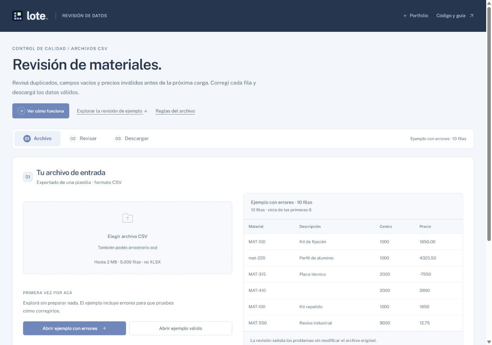

# Lote

Revisión de archivos CSV de materiales. Detecta campos vacíos, claves repetidas y valores fuera del perfil; permite corregir filas y descargar el resultado.

[Abrir la aplicación](https://enriqueariellopez.github.io/lote-data-quality/)



## Uso

1. **Archivo:** elegí un CSV o uno de los ejemplos. La vista previa muestra las primeras seis filas; la revisión procesa el archivo completo.
2. **Revisar:** consultá las incidencias y abrí una fila para corregirla. Cada cambio vuelve a validar todo el lote. Podés deshacer las últimas 20 correcciones.
3. **Descargar:** exportá las filas sin errores bloqueantes, las incidencias en CSV o el reporte completo en JSON.

El mapa permite abrir las primeras 48 filas y aclara ese límite cuando corresponde. La lista de incidencias tiene búsqueda, filtros y páginas; no representa todas las filas del archivo. Los indicadores siempre resumen el lote completo.

**Normalizar espacios y mayúsculas** es opcional. Cada modificación se informa como advertencia. Desactivarla recupera los valores de origen, con las correcciones que hayas guardado. Lote marca todas las apariciones de una clave repetida; no decide cuál conservar.

La guía **Ver cómo funciona** utiliza datos separados y no cambia tu revisión. El video narrado del final muestra una interfaz anterior.

## Preparar el CSV

UTF-8, coma o punto y coma, hasta 2 MB y 5.000 filas. Las ocho cabeceras son obligatorias; pueden venir en otro orden. No se admiten duplicadas ni columnas extra. Cada celda admite hasta 2.000 caracteres.

```csv
material,descripcion,tipo,unidad,grupo,centro,precio,moneda
MAT-100,Kit de fijación,FERT,UN,010,1000,1850.00,ARS
```

| Campo | Regla del perfil incluido |
| --- | --- |
| `material` | De 1 a 18 letras mayúsculas, números o guiones |
| `descripcion` | Texto de hasta 40 caracteres |
| `tipo` | FERT, HALB, ROH o HAWA |
| `unidad` | UN, KG, LT o M |
| `grupo` | Tres dígitos, conservando ceros iniciales |
| `centro` | 1000 o 2000 |
| `precio` | No negativo, punto decimal y hasta dos decimales, sin miles; cero advierte |
| `moneda` | ARS o USD |

Todos los campos son obligatorios. La combinación `material + centro` debe ser única. La primera fila de datos es la 2; un campo multilínea sigue contando como una sola fila. Consultá **Reglas del archivo** desde la aplicación.

[Ejemplo válido](examples/materiales-validos.csv) · [Ejemplo con errores](examples/materiales-errores.csv)

## Datos y límites

El archivo se procesa en la memoria del navegador. No se sube a un servidor ni se conserva al recargar o cerrar la pestaña. Descargar no sobrescribe el archivo original. No abre XLSX: exportá primero la planilla como CSV.

El perfil es una demostración inspirada en preparación de materiales; no constituye una especificación universal de SAP ni se conecta a ese sistema. Confirmá cada corrección con la fuente de tus datos.

## Ejecutar localmente

Con Python 3.10+:

```sh
python -m http.server 4182 --bind 127.0.0.1
```

Abrí `http://127.0.0.1:4182`. No hay instalación de paquetes ni compilación. Se necesita HTTP para cargar los módulos y el perfil de reglas.

## Uso por consola

Usa Python 3.10+ y su biblioteca estándar:

```sh
python python/lote.py examples/materiales-validos.csv
python python/lote.py examples/materiales-errores.csv --normalize --format json
python python/lote.py examples/materiales-errores.csv --report revision.json --valid validos.csv
python python/lote.py --help
```

Códigos de salida: 0 sin errores bloqueantes (puede haber advertencias), 1 con errores de datos y 2 si no se pudo procesar el archivo.

## Código y pruebas

| Ruta | Función |
| --- | --- |
| `rules.json` | Perfil compartido por el navegador y Python |
| `src/validator.js`, `python/lote.py` | Lectura, reglas y exportación |
| `src/app.js` | Revisión, correcciones e historial |
| `src/file-preview.js` | Tabla de muestra con valores tratados como texto |
| `src/review-flow.js` | Navegación entre archivo, revisión y descarga |
| `src/tutorial.js` | Guía independiente de la revisión |
| `style.css`, `interface.css` | Base y presentación de la aplicación |
| `tests/` | CSV, reglas y comparación JavaScript/Python |

La interfaz usa Public Sans servida localmente; su licencia SIL OFL está en `assets/`.

Con Node 22+ y Python 3.10+, sin instalar paquetes:

```sh
npm test
```

`LOTE_PYTHON` permite indicar otro ejecutable de Python al runner. Las pruebas incluyen claves duplicadas, normalización, límites de precio, exportación y paridad entre implementaciones. La exportación protege posibles prefijos de fórmulas; las pruebas verifican el archivo, no todas las aplicaciones de planillas. La CSP de la página es parcial.

GitHub Pages publica `main` después de la revisión y las pruebas. El workflow vigente usa Node 20; su migración requiere un permiso de GitHub que no tiene la credencial de esta sesión.
